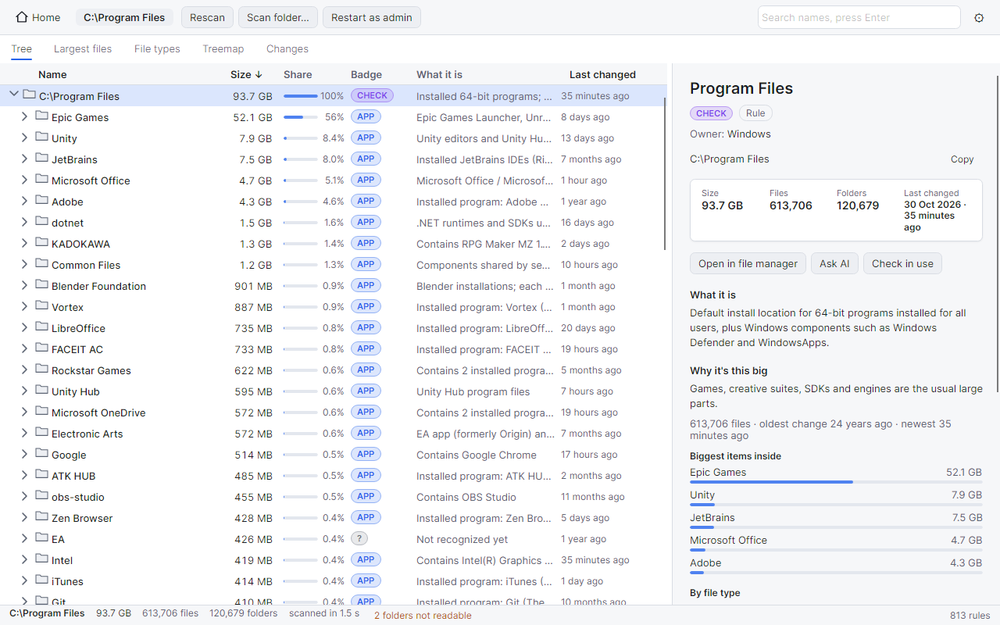
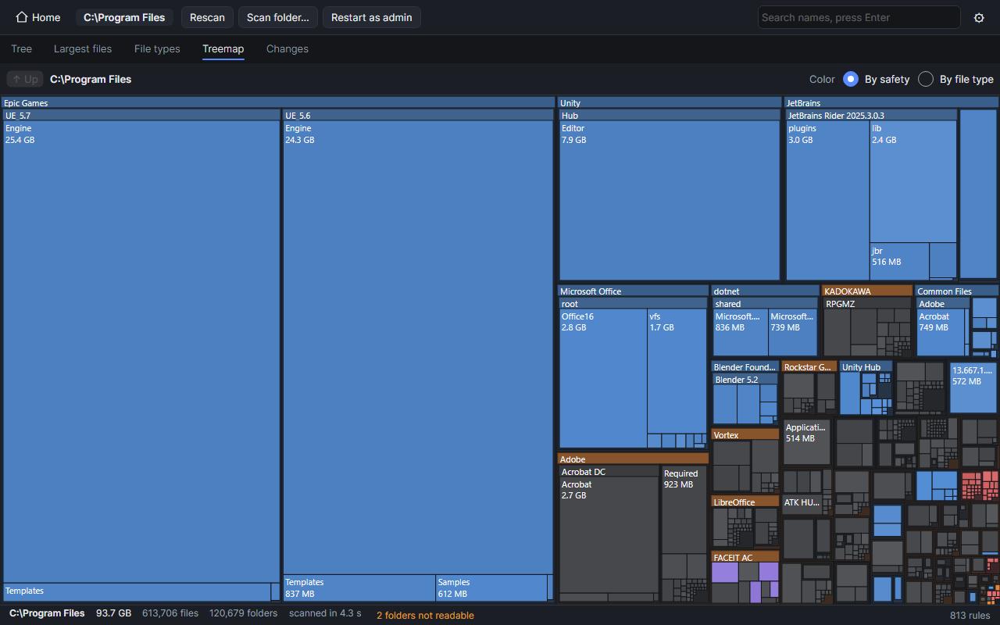
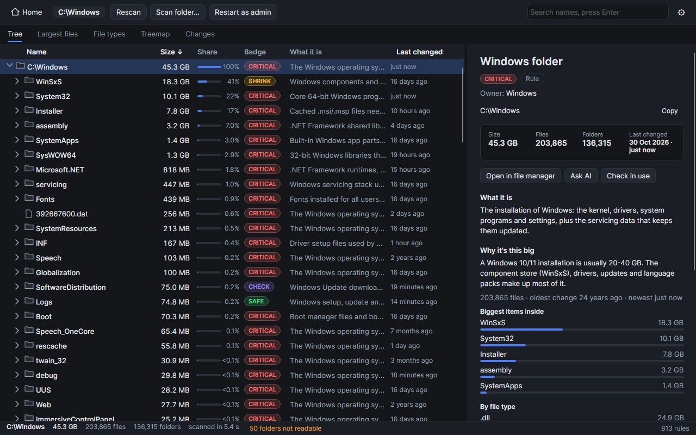

# DiskLore

[](https://github.com/OWNER/disklore/actions/workflows/ci.yml)

Why is this folder 50 GB, and can I delete it? Disk usage tools show you the
sizes and leave the guessing to you. DiskLore is a desktop disk usage explorer
that puts a safety badge and a plain-English note on every folder and file: what
it is, why it is big, what happens if you delete it, and a safer way to shrink
it. It runs on Windows, Linux and macOS; Windows is the primary platform.

## Screenshots

| | |
|---|---|
|  |  |
|  |  |

## Features

- Fast parallel scan of a drive or folder; size-sorted tree with percentages.
- A badge and a one-line note on every row; the full explanation in a side panel.
- Built-in knowledge base (JSON rules) for Windows system folders, package
  manager caches, game launchers, browsers, IDEs and common project folders.
- Live facts under every explanation: top children, top file extensions, file
  count, largest file, oldest and newest modification time.
- Installed-program detection, and leftover detection for programs that are no
  longer installed (Windows).
- Optional explanations from Claude for unknown big folders.
- Treemap, largest files, file type breakdown, and scan-to-scan "what grew" diffs.
- Recycle Bin / Trash and permanent delete, with an in-use check and an extra
  confirmation for critical items. Junctions and symlinks are never followed.
- Several color themes, including a high-contrast theme.

## Badges

| Badge | Meaning | Example |
|---|---|---|
| CRITICAL | Windows or boot breaks if removed. | `Windows\System32` |
| SHRINK | Needed, but can be shrunk through an official method. | `WinSxS` (DISM), `hiberfil.sys` (powercfg) |
| APP | Belongs to an installed program; remove it with the uninstaller. | `Program Files\Unity` |
| CHECK | Mixed contents; look inside before deleting. | `ProgramData`, `AppData\Roaming` |
| SAFE | Cache, temp files or regenerable data. | `npm-cache`, `Temp`, Unity `Library` |
| LEFTOVER | The program is no longer installed; leftover data. | `AppData\Local\OldVendor` |
| USER | Your own files; DiskLore cannot judge them. | `Videos`, `Documents` |
| UNKNOWN | No rule matched. | |

## How explanations work

DiskLore asks these sources in order and uses the first answer:

1. **Curated rules.** JSON files in `src/DiskLore.Core/Knowledge/`, written and
   reviewed by hand. Specific path rules beat generic name rules.
2. **Installed programs.** A folder inside an installed program's location (or a
   Store app package) is tagged APP and linked to the program.
3. **Leftover heuristic.** On Windows, a top-level folder in AppData, ProgramData
   or Program Files that matches no installed program is tagged LEFTOVER with a
   low confidence.
4. **Claude (optional).** For unknown big folders only; see below.

Items inside a folder with an inheriting rule are marked as part of that folder.
Explanations that come from AI carry an "AI" tag and a confidence value, so they
are never confused with curated rules. An AI answer can never mark an item
CRITICAL or SHRINK, and anything under the Windows directory, Program Files or
the system root files is never marked SAFE (it is downgraded to CHECK).

## Download

Get the latest build from the
[GitHub Releases](https://github.com/OWNER/disklore/releases) page. You can
verify the download against `SHA256SUMS.txt`.

| Platform | File | Notes |
|---|---|---|
| Windows x64 | `DiskLore-<version>-win-x64.zip` | Unzip and run `DiskLore.exe`. The exe is not code-signed, so SmartScreen shows "Windows protected your PC": choose "More info", then "Run anyway". |
| Linux x64 | `DiskLore-<version>-linux-x64.tar.gz` | Extract with `tar xzf`, run `chmod +x DiskLore/DiskLore` if needed, then start it. |
| macOS (Apple silicon) | `DiskLore-<version>-osx-arm64.zip` | Unzip, then run `xattr -dr com.apple.quarantine DiskLore.app` because the app is not signed or notarized. |
| macOS (Intel) | `DiskLore-<version>-osx-x64.zip` | Same as above. |

The builds are self-contained; you do not need to install .NET.

### Run as administrator

A normal user cannot read some system folders (for example `System Volume
Information`), so those show as unreadable and their size is missing from the
totals. To scan a whole system drive, restart DiskLore as administrator from the
app (Windows) or start it with `sudo` (Linux and macOS).

## Claude explainer

This is optional. It needs the [Claude Code](https://claude.com/claude-code) CLI
installed and logged in. DiskLore calls `claude -p` on your machine, so the
request goes through your own account and DiskLore has no API key of its own.

- By default it looks at unknown items of 1 GB or more, in batches of up to 5,
  with at most 8 calls per scan. The "Ask Claude" button asks about any single row.
- What is sent: the path (with your user profile replaced by `%USERPROFILE%` or
  `~`), the size and file count, the names and sizes of the top children, the top
  file extensions, up to 30 file and folder names, and the installed-program
  match and parent explanation if there are any. File contents are never sent.
- Answers are cached in `ai-cache.json`, so the same folder is not asked twice.
- To turn it off, set the AI mode to off in Settings. If the `claude` command is
  not on your PATH, the feature is unavailable and everything else works as usual.

Details: [docs/privacy.md](docs/privacy.md).

## Platform support

| Feature | Windows | Linux | macOS |
|---|---|---|---|
| Scanning | Yes | Yes | Yes |
| Knowledge-base rules | Yes | Yes | Yes |
| Claude explainer | Yes | Yes | Yes |
| Treemap, largest files, file types, diffs | Yes | Yes | Yes |
| Recycle Bin / Trash | Recycle Bin | Trash | Trash |
| Permanent delete | Yes | Yes | Yes |
| Installed-program detection | Yes | No | No |
| Leftover detection | Yes | No | No |
| In-use check before delete | Yes (Restart Manager) | No | No |
| Elevated "safer way" commands | Yes (UAC) | Copy to clipboard | Copy to clipboard |
| Explorer right-click "Open in DiskLore" | Yes | No | No |

Most rules in the knowledge base are Windows specific for now; Linux and macOS
rules are welcome (see below).

## Build from source

You need the .NET 10 SDK (see `global.json`).

```
dotnet build DiskLore.sln
dotnet test
dotnet run --project src/DiskLore.App
```

To open a folder directly: `dotnet run --project src/DiskLore.App -- "/some/folder"`.

To build the release packages, run `scripts/publish.ps1` (PowerShell) or
`scripts/publish.sh`; the output lands in `dist/`.

## Contributing

The most useful contribution is a knowledge-base rule: a JSON entry that
explains a folder DiskLore does not know yet. See [CONTRIBUTING.md](CONTRIBUTING.md)
and [docs/knowledge-base.md](docs/knowledge-base.md). The product spec is in
[docs/spec.md](docs/spec.md) and the code layout in
[docs/architecture.md](docs/architecture.md). To report a security problem, see
[SECURITY.md](SECURITY.md).

## License

[MIT](LICENSE)
